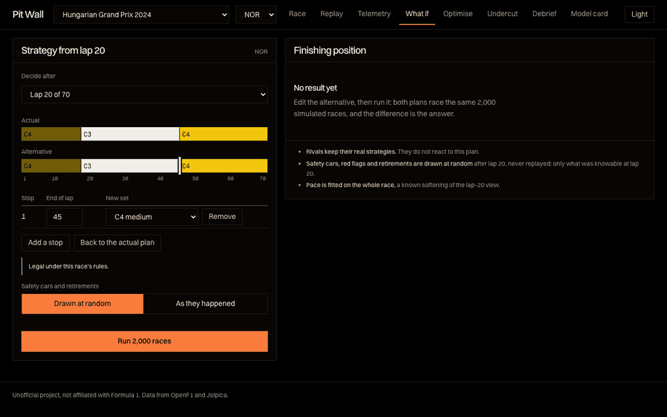
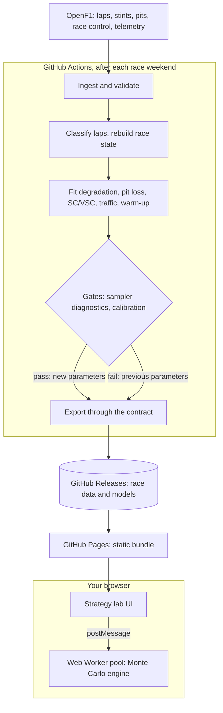

# Pit Wall

[](https://github.com/tomeelow/pit-wall/actions/workflows/ci.yml)
[](https://github.com/tomeelow/pit-wall/actions/workflows/weekend.yml)
[](https://tomeelow.github.io/pit-wall/)


[](https://openf1.org)

**What if they had pitted three laps earlier?** Pit Wall re-runs real Formula 1 races thousands of
times to test strategy calls, and tells you how sure it can be about the answer.

**[Open Pit Wall](https://tomeelow.github.io/pit-wall/)** to explore 90 races from 2023 to 2026.
It runs in your browser: nothing to install, no account, no server.



*Hungary 2024, from lap 20: what if Norris had stopped on lap 37 instead of lap 45? Across 2,000
simulated races, the earlier stop finishes ahead of the real strategy 16 % of the time, behind it
28 % of the time, and costs a quarter of a place on average.*

## What you can do

Pick a race and a driver at the top of the page, then choose a tool:

| Tool | What it answers |
|---|---|
| **Race** | Who ran which tyres, when everyone stopped, and when safety cars came out. |
| **Replay** | The race on a track map, lap by lap, with a scrubber. |
| **Telemetry** | Two drivers' fastest laps side by side: speed, throttle, brake, gear, and where one gained time on the other. |
| **What if** | Change a driver's pit stops (laps and tyres) and race the new plan against the real one. |
| **Optimise** | Search every sensible plan from a given lap for the best finishing position, a podium, points, or beating a chosen rival. |
| **Undercut** | Should a driver stop a lap before the car ahead, or a lap after? The chance of coming out in front. |
| **Debrief** | Every pit stop a driver made, judged twice: was it a good call with what was known then, and did it work out? |
| **Model card** | How the models were fitted, and how well the simulator has predicted real races. |

Wet and mixed-weather races show the race, replay and telemetry, but can't be simulated.

## Reading an answer

Races are unpredictable, so Pit Wall never gives one finishing position. Each answer is a spread of
outcomes from thousands of simulated races, like *P3 in 40 % of them, P4 in 30 %, P2 in 15 %…*

When two plans are compared, both run through **the same** simulated races: the same safety cars,
retirements and slow stops. Any difference between them is down to the plan, not luck. You get:

- **% ahead / % behind:** how often the new plan finishes in front of the real one, and behind it;
- **places gained on average**, with its margin of error.

**Safety cars: "drawn at random" or "as they happened".** Drawn at random (the default) asks *was it
a good call?*: only what the team could know at that lap is used, and later safety cars,
retirements and slow stops are simulated. As they happened asks *did it work out?*, with hindsight.
Pit Wall keeps the two apart and never blends them into one number.

**Every answer assumes rivals keep their real strategies.** If the driver you're testing stops
earlier, nobody else reacts to it. Each screen says so next to the result.

### F1 terms used here

| Term | Meaning |
|---|---|
| Stint | The laps run on one set of tyres, between two pit stops. |
| Compound, C1–C6 | Pirelli's tyre types, from hardest (C1) to softest (C6). "Soft", "medium" and "hard" are just the three chosen for a race, so the same label means different tyres at different tracks. |
| Degradation | How much slower a set of tyres gets with every lap it runs. |
| Undercut / overcut | Stopping before the car ahead to pass it on fresh tyres, or staying out longer than it. |
| Safety car (SC), VSC, red flag | Ways the race is slowed or stopped after an incident. A pit stop under a safety car or VSC costs less time. |
| Pit loss | The time a stop costs compared with staying out: driving through the pit lane plus the time stationary. It differs by track. |

## How much to trust it

Pit Wall checks itself against real results. It re-simulates 75 dry races from four points in each
race (after lap 1, a quarter, half and three quarters of the way), using the drivers' real
strategies, and asks: does the real result land where the simulator said it probably would?

If the simulator is honest about its uncertainty, the real finishing position should fall inside
its "likely" range (the middle 50 % of outcomes) about half the time, and inside its "plausible"
range (the middle 80 %) about 80 % of the time. Lower than that means it's too sure of itself.

| Simulating from… | Inside the 50 % range | Inside the 80 % range | Better than "finish where you are now"? |
|---|---|---|---|
| All starting points | 49 % | 78 % | Yes |
| After lap 1 | 53 % | 83 % | Yes |
| Half distance | 48 % | 78 % | Yes |
| Three quarters | 44 % | 71 % | Yes, by less |
| Races with no safety car after that point | 52 % | 82 % | Yes |
| Races where a safety car, VSC or red flag came later | 44 % | 73 % | Yes |

Overall it is honest about its uncertainty, and always more informative than assuming the order
stays as it is. Where it is **too sure of itself**:

- **The last quarter of a race.** Rivals can't defend, make late reactive stops or make mistakes,
  so a few laps of simulated racing leave too little room for surprises.
- **Races where a safety car actually came out later.** When judging a call, the simulator doesn't
  know a safety car is coming; it can only allow for one at random. That's deliberate: a decision
  should be judged on what the team could know.
- **Wet or mixed races** aren't simulated at all. Neither is Miami 2025, where the timing data has
  gaps.

The scores behind this table (log scores and the full breakdown) are on the site's Model card and
under Phase 7 in [the implementation plan](docs/implementation_plan.md).

### Known weaknesses of the strategy tools

- **The debrief tends to say "stop later".** Rivals can't react, so stopping early to cover a
  rival's undercut earns nothing, and tyre wear gets steadily worse but never suddenly falls off a
  cliff. Treat "should have stopped later" on a first stop as a hint, not proof of a mistake. To
  keep its suggestions realistic, the search never proposes a stint longer than other races have
  run on that tyre.
- **A stop made because of a safety car** is judged as if it had been planned on a green-flag lap.
- **Undercut chances above 60 % are too confident.** On the few real cases seen, a predicted 70 %
  happened 48 % of the time (`make undercut-check`).
- **The optimiser assumes every tyre type is available as a new set.** Which sets a driver had
  left isn't in the data.

## How it works



After every race weekend, an automated job downloads the new race, refits the models and checks
them. Only models that pass every check are published; otherwise the previous ones stay live. Your
browser then runs the simulations itself, spread across your CPU cores.

What goes into a simulated lap:

- **Tyres and fuel.** A car gets faster as it burns fuel and slower as its tyres wear, and the two
  nearly cancel out within a stint. Pit Wall separates them, because changing when a driver stops
  changes the tyres' age but not the fuel load. [The write-up](docs/blog/fuel-and-tyres.md)
  explains why this matters, and what goes wrong without it.
- **Every driver, team and track.** Tyre wear is estimated per tyre type, track and team. Where a
  team has little data, the estimate leans on other teams and tracks. The 2026 cars are modelled
  separately from 2023–25.
- **Traffic.** A car close behind another loses time in its dirty air; whether it gets past depends
  on the gap, the pace difference and DRS.
- **Pit stops and incidents.** Pit loss per track, real stop times (slow ones included), and safety
  cars, VSCs, red flags and retirements at the rates seen in other races.
- **Honest uncertainty.** Every simulated race uses a slightly different version of every model,
  drawn from how uncertain the fit is, so the spread of outcomes includes what the models don't
  know.

Engineering choices, briefly: Python fits the models, and TypeScript runs the only simulator, the
same code in your browser and in the checks
([ADR-001](docs/adr/001-python-fits-typescript-simulates.md)). Race data and models live in GitHub
Releases and the site on GitHub Pages, so running it costs nothing
([ADR-008](docs/adr/008-releases-store-pipeline-data.md)). The decisions are in [docs/adr](docs/adr/).

## Data and credits

| What | Amount |
|---|---|
| Races | 90 (2023 round 1 to 2026 round 20); 75 can be simulated |
| Laps | 100,749; the 50.5 % run in clean air with no incident are the ones the pace models learn from |
| Telemetry | Every driver's fastest lap at pace (1,734 laps), and one lap of track position per race |
| Tyre allocations | Hand-kept from Pirelli's published allocations in `config/compound_allocation.yaml`, with sources |

All race data comes from [OpenF1](https://openf1.org), which is free and needs no key.
[Jolpica](https://github.com/jolpica/jolpica-f1) is planned for older results.

## For developers

You need [uv](https://docs.astral.sh/uv/), Node 22.12+ (CI uses 24), npm and the
[GitHub CLI](https://cli.github.com) (to download the published data).

```bash
make setup
```

Download the published races and models, build the site's data and start it locally:

```bash
make data-pull
```

```bash
make export
```

```bash
make dev
```

Before you call a change done, run what CI runs (Python: ruff, pyright, pytest; web: tsc, eslint,
vitest; plus a check that the generated contract is up to date):

```bash
make verify
```

### Building the data yourself

```bash
make ingest SEASON=2024
```

Each race is validated before it is saved; `.data/races/<season>/summary.json` lists any errors
and warnings. Then fit the models and check the simulator:

```bash
make fit && make fit-events && make fit-traffic && make fit-warmup
```

```bash
make export && make validate-sim && make export
```

A model that fails its checks (R̂, effective sample size, divergences, calibration) is not saved,
and the previous one stays. `make export` fails if a file is over the size limits in
`config/budgets.yaml`.

### Publishing

The `weekend` workflow runs every Monday, and every Wednesday to catch results changed by late
penalties. It runs the same command you can run locally:

```bash
make weekend PUBLISH=1
```

It adds the season's new races, downloads the previous race again, and refits and rechecks
everything if anything changed. Without `PUBLISH=1` nothing is uploaded; the run's summary is in
`.data/weekend.md`. The deploy needs GitHub Pages set to deploy from GitHub Actions.

### Where things are

| Path | What |
|---|---|
| `pipeline/` | Python: download, clean, fit, validate, export |
| `web/` | TypeScript: the site and the simulator (`web/src/sim/`) |
| `contract/` | JSON Schema of the files the pipeline publishes, generated from `pipeline/src/pitwall/export/contract.py` |
| `config/` | Seasons, tyre allocations, teams, regulations, thresholds, size limits |
| `docs/` | [Implementation plan](docs/implementation_plan.md), [decisions (ADRs)](docs/adr/) and a [write-up](docs/blog/fuel-and-tyres.md) |

## What's next

- **Rivals that react.** Letting other cars respond to a strategy, for example by covering an
  undercut, is the biggest known gap
  ([ADR-004](docs/adr/004-open-loop-opponents.md)). Letting cars bring a stop forward under a
  simulated safety car was tried and made no measurable difference, so it isn't used.
- **A tyre cliff,** if the data ever shows one; teams usually stop before it.
- **Live races.** Pit Wall analyses finished races only
  ([ADR-005](docs/adr/005-post-race-only.md)); live timing is a paid OpenF1 tier.
- **Sprint races** and **wet-weather strategy.**

---

Unofficial fan project, not affiliated with Formula 1, the FIA or any team. Race data from
[OpenF1](https://openf1.org).
