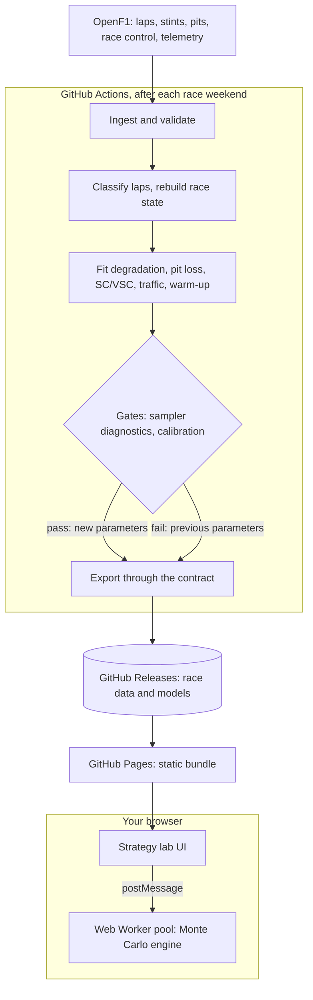

# Pit Wall

A race strategy lab for Formula 1. Pick a race and a driver and ask "what if he had pitted eight
laps earlier?", "one stop or two?" or "could he have undercut the car ahead?". Pit Wall races the
alternative against what really happened, thousands of times, and answers with a distribution of
finishing positions, not a single number. The simulator is calibrated against real races, and the
calibration is published here, including where it fails. Models are refitted in GitHub Actions
after each race weekend and published as static files; the simulation runs in your browser.
There is no server.

**[Open Pit Wall](https://tomeelow.github.io/pit-wall/)**: 90 races from 2023 to 2026, with the
dry ones simulated.


*Hungary 2024, from lap 20: Norris stops on lap 37 instead of 45. Over the same 2,000 simulated
races, the earlier stop finishes ahead in 16 % of them and behind in 28 %, and costs 0.25 places on
average.*

## How it works



- **Python fits, TypeScript simulates.** `pipeline/` ingests, cleans and fits; `web/src/sim/` is
  the only simulation engine. CI validates the simulator by running that same engine under Node,
  so the engine that was validated is the one users run ([ADR-001](docs/adr/001-python-fits-typescript-simulates.md)).
- **One contract between them.** Pydantic models in `pipeline/src/pitwall/export/contract.py`
  generate the JSON Schema and the TypeScript types; CI fails if they are stale.
- **Zero running cost.** GitHub Releases hold the race data and models
  ([ADR-008](docs/adr/008-releases-store-pipeline-data.md)), Pages serves the site, and every
  simulation runs in Web Workers on the visitor's machine.

## The modelling story

**Fuel and tyres are confounded.** Within a stint, tyre age rises while the fuel load falls and the
track rubbers in. Fit lap time on tyre age alone and fuel burn-off looks like *negative* tyre wear.
The two are separable only because tyre age resets at each stop and fuel does not, so every
lap-time model carries an explicit race-lap fuel term with a physics prior (about 0.03 s/kg in
2023–25). In a typical stint the two nearly cancel: fuel is worth about −0.06 s a lap and wear about
+0.05 s. A strategy simulator needs them apart, because a longer stint changes the tyre age without
changing the fuel curve.

**Partial pooling.** Degradation is a hierarchical Bayesian model
([ADR-002](docs/adr/002-hierarchical-bayesian-degradation.md)). Slopes are fitted per era and
Pirelli C-number, then per track, then per team, with each level shrunk towards the one above. A
team with few laps on a compound at one track borrows strength from the other teams and tracks.
Compounds are keyed by C-number, never by soft, medium or hard: those labels are relative to each
event. 2023–25 and 2026 are separate eras, never pooled.

**Common random numbers.** When two strategies are compared, simulation *i* sees the same safety
cars, retirements, pit-stop times, lap-time noise and posterior draw under both. The difference
between the plans is then the effect of the plan, not of luck, and 2,000 runs resolve a quarter of a
place.

**Uncertainty is propagated.** Each simulated race samples one of 200 posterior draws of every
model's parameters. Point estimates would make the distribution falsely narrow.

**The information-set rule.** A counterfactual from lap N uses only what was knowable at lap N.
Safety cars, red flags, retirements and slow stops after lap N are sampled, never replayed. The
debrief keeps two separate verdicts: ex ante ("was it a good call with what was known?") and ex
post ("did it work out?"). One known softening: pace and degradation are fitted on the whole race,
the simulated one included. Random events never are.

## Calibration, including where it fails

`make validate-sim` backtests the engine on every simulable race (75 dry races), from four points
in each race, 1,000 ex-ante runs per start, with the drivers' actual strategies and sampled events.
Coverage is the share of real results inside the simulated 50 % and 80 % intervals (randomised PIT,
so a calibrated forecast scores 0.50 and 0.80). The log score is compared with "finish where you are
now" and "finish where you were after lap 1"; higher is better.

| Segment | Coverage 50 % | Coverage 80 % | Log score | Order at start lap | Order after lap 1 |
|---|---|---|---|---|---|
| All | 0.49 | 0.78 | **−1.93** | −2.38 | −2.60 |
| From after lap 1 | 0.53 | 0.83 | **−2.11** | −2.59 | −2.59 |
| From 50 % distance | 0.48 | 0.78 | **−1.87** | −2.36 | −2.61 |
| From 75 % distance | 0.44 | 0.71 | **−1.69** | −1.98 | −2.58 |
| No SC, VSC or red flag after the start | 0.52 | 0.82 | **−1.68** | −2.26 | −2.55 |
| A real SC, VSC or red flag after the start | 0.44 | 0.73 | **−2.26** | −2.54 | −2.66 |

The simulator beats both baselines in every segment. Where it is **not** well calibrated:

- **The last quarter of a race:** too confident. Opponents cannot make late reactive stops, defend
  or make mistakes, so a few laps of open-loop racing leave too little spread.
- **Races where a safety car, VSC or red flag actually happened** after the start point: too
  confident. Ex ante those events are only sampled, which is the price of the information-set rule.
- **Wet or mixed races:** not simulated at all. Neither is Miami 2025, where OpenF1's race times
  have gaps.

The full table, the PIT histogram and the publish gate are under Phase 7 → Findings in
[the implementation plan](docs/implementation_plan.md). The site's model card shows the same
numbers.

### Strategy tools: known weaknesses

- **The debrief prefers later stops.** Rivals cannot react, so covering an undercut is worth
  nothing, and tyre wear is linear, with no cliff. Its "should have stopped later" verdicts on first
  stops are therefore not evidence of a mistake.
- **Plans cannot react either.** A stop the team made because a safety car came out is judged, ex
  ante, as a planned green-flag stop.
- **Undercut probabilities above 0.6 are too confident** on the few real pairs seen: predicted
  0.70, happened 0.48. `make undercut-check` has the full table.
- **The optimiser assumes every compound is available on a new set.** Which sets a driver had left
  is not in the data.

## Data

| What | Amount |
|---|---|
| Races | 90 (2023 R1 to 2026 R20); 75 simulable |
| Laps | 100,749, of which 50.5 % are clean: the only laps the pace models are fitted on |
| Telemetry | Every driver's fastest lap at pace, 1,734 laps; one lap of track location per race |
| Pirelli compound allocations | Hand-maintained in `config/compound_allocation.yaml`, with the press release cited per season |
| Published store | 46 MB of race data, 2.4 MB of models |

All race data comes from [OpenF1](https://openf1.org) (free, no key, 2023 onwards;
[ADR-006](docs/adr/006-openf1-backbone.md)). [Jolpica](https://github.com/jolpica/jolpica-f1) is
planned for results history. Every model and bundle records the dataset hash and git commit it was
built from. Every raw response is cached, and finished seasons are never pulled again.

## Run it

Needs [uv](https://docs.astral.sh/uv/), Node 22.12+ (CI uses 24), npm and, to fetch the published
data, the [GitHub CLI](https://cli.github.com).

```bash
make setup
```

```bash
make verify
```

Get the published races and models, export the bundle and start the app:

```bash
make data-pull
```

```bash
make export
```

```bash
make dev
```

`make verify` is what CI runs: ruff, pyright and pytest; tsc, eslint and vitest; contract freshness.

### Building the data yourself

```bash
make ingest SEASON=2024
```

Ingest validates each race before writing it; `.data/races/<season>/summary.json` lists every
race's errors and warnings. It also fetches the fastest-lap traces
([ADR-007](docs/adr/007-fastest-lap-traces.md)). Then fit and validate:

```bash
make fit && make fit-events && make fit-traffic && make fit-warmup
```

```bash
make export && make validate-sim && make export
```

Each fit has its own gate (R̂, effective sample size, divergences); a failed gate keeps the
previous parameters. `make export` fails if a file is over the size budgets in
`config/budgets.yaml`.

### Publishing

The `weekend` workflow runs on Mondays, and on Wednesdays for amended results. It runs the same
command you can run locally:

```bash
make weekend PUBLISH=1
```

It ingests the season's new races and pulls the previous race again. If anything changed, it
refits every model and applies every gate. If a gate fails, the previous parameters stay live and
the new race publishes without a simulation. Without `PUBLISH=1` nothing is uploaded; the run's
summary is in `.data/weekend.md`. The deploy workflow needs GitHub Pages set to deploy from GitHub
Actions.

## What I'd do with more time

- **Reactive opponents.** Rivals keep their real strategies ([ADR-004](docs/adr/004-open-loop-opponents.md)).
  Letting them cover an undercut or pit under a safety car is the biggest known gap, and the most
  likely fix for the late-race overconfidence.
- **A tyre cliff.** Wear is linear because the residuals show no curvature, even 30+ laps into a
  stint. Teams usually stop before a cliff, so the data may simply not contain one.
- **Live mode.** v1 is post-race only ([ADR-005](docs/adr/005-post-race-only.md)); live OpenF1
  data is a paid tier.
- **Sprint races** and **wet-weather strategy**, neither of which is modelled.

## Layout

| Path | What |
|---|---|
| `pipeline/` | Python (uv): ingest, classify, fit, validate, export |
| `web/` | TypeScript (Vite + React): the UI and the simulation engine (`web/src/sim/`) |
| `contract/` | JSON Schema of the exported files, generated from the pipeline's contract |
| `config/` | Seasons, compound allocations, teams, regulations, thresholds, size budgets |
| `docs/` | [Implementation plan](docs/implementation_plan.md), [ADRs](docs/adr/) and a [write-up](docs/blog/fuel-and-tyres.md) |

Unofficial project, not affiliated with Formula 1, the FIA or any team. Race data from
[OpenF1](https://openf1.org).
